

<a href="https://victorllerena.com"><picture><source media="(prefers-color-scheme: dark)" srcset="assets/generated/hero-dark.svg"></picture></a>

<a href="https://victorllerena.com"><picture><source media="(prefers-color-scheme: dark)" srcset="assets/generated/btn-web-dark.svg"></picture></a>
<a href="https://www.linkedin.com/in/vllerena/"><picture><source media="(prefers-color-scheme: dark)" srcset="assets/generated/btn-linkedin-dark.svg"></picture></a>
<a href="https://victorllerena.com/agenda"><picture><source media="(prefers-color-scheme: dark)" srcset="assets/generated/btn-agenda-dark.svg"></picture></a>
<a href="https://wa.me/51925786403"><picture><source media="(prefers-color-scheme: dark)" srcset="assets/generated/btn-whatsapp-dark.svg"></picture></a>
<a href="mailto:hola@victorllerena.com"><picture><source media="(prefers-color-scheme: dark)" srcset="assets/generated/btn-email-dark.svg"></picture></a>

### Sobre mí

Soy ingeniero de sistemas y llevo más de 6 años construyendo software. Hoy soy **CRM & AI Manager en Impulse**, el primer partner Diamond de HubSpot en Perú, donde diseño arquitecturas de CRM, integraciones y agentes de IA para empresas de LATAM. En paralelo construyo **[Stackea Labs](https://stackealabs.com)**, mi marca de productos API para el mercado peruano.

Lo más importante lo aprendí con un CRM técnicamente impecable que nadie usó: los vendedores eran de campo y vendían por WhatsApp, desde el celular. Desde entonces **trabajo desde el problema, no desde la herramienta**.

<picture><source media="(prefers-color-scheme: dark)" srcset="assets/generated/proof-dark.svg">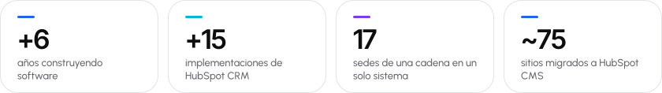</picture>

**Lo que aporto a un equipo**

- **CRM y RevOps** — arquitectura e implementación de HubSpot Enterprise, automatización y reporting. 10 certificaciones vigentes de HubSpot Academy.
- **Integraciones** — APIs, webhooks y middleware entre CRM, ERP, ecommerce, POS, WhatsApp y facturación SUNAT.
- **Producto fullstack** — de la base de datos al deploy: Laravel o NestJS, React, Vue o Next.js, PostgreSQL, multi-tenant.
- **IA aplicada** — agentes con tool calling, MCP y automatización con n8n, con revisión humana donde importa.
- **Liderazgo** — fui docente 5 años antes de programar: lidero reuniones, capacito equipos y explico lo técnico a negocio.

### Lo que estoy construyendo ahora

**[Stackea Labs](https://stackealabs.com)** — los tres dolores que se repetían en cada sistema que desarrollaba (identificar al cliente, facturarle y escribirle), convertidos en productos API multi-tenant.

<a href="https://acredita.stackealabs.com"><picture><source media="(prefers-color-scheme: dark)" srcset="assets/generated/card-acredita-dark.svg">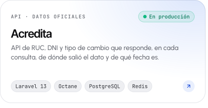</picture></a><a href="https://comprobia.stackealabs.com"><picture><source media="(prefers-color-scheme: dark)" srcset="assets/generated/card-comprobia-dark.svg">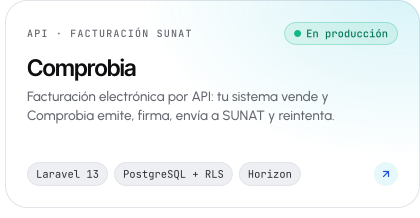</picture></a>
<a href="https://avisa.stackealabs.com"><picture><source media="(prefers-color-scheme: dark)" srcset="assets/generated/card-avisa-dark.svg">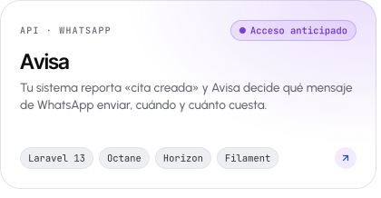</picture></a><a href="https://acopla.stackealabs.com"><picture><source media="(prefers-color-scheme: dark)" srcset="assets/generated/card-acopla-dark.svg">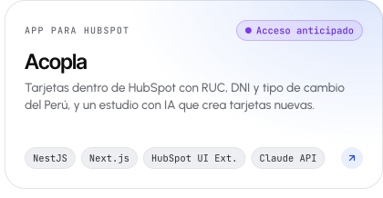</picture></a>

### Proyectos

Casi todo mi código vive en repositorios privados, de clientes y de producto. Cada tarjeta lleva al caso completo.

<a href="https://victorllerena.com/proyectos/podoplus-app"><picture><source media="(prefers-color-scheme: dark)" srcset="assets/generated/card-podoplus-dark.svg">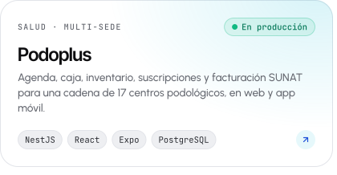</picture></a><a href="https://victorllerena.com/proyectos/disena-app"><picture><source media="(prefers-color-scheme: dark)" srcset="assets/generated/card-disena-dark.svg">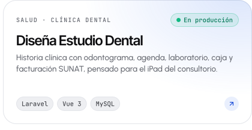</picture></a>
<a href="https://victorllerena.com/proyectos/farmaorden"><picture><source media="(prefers-color-scheme: dark)" srcset="assets/generated/card-farmaorden-dark.svg">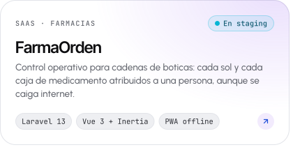</picture></a><a href="https://victorllerena.com/proyectos/ark-gamer-store"><picture><source media="(prefers-color-scheme: dark)" srcset="assets/generated/card-arkgamer-dark.svg">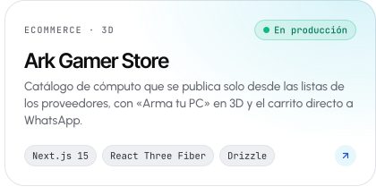</picture></a>
<a href="https://victorllerena.com/proyectos/atiende"><picture><source media="(prefers-color-scheme: dark)" srcset="assets/generated/card-atiende-dark.svg">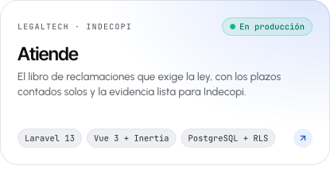</picture></a><a href="https://victorllerena.com/proyectos/doctia"><picture><source media="(prefers-color-scheme: dark)" srcset="assets/generated/card-doctia-dark.svg">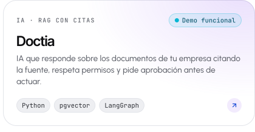</picture></a>

<a href="https://victorllerena.com/proyectos"><b>Ver todos los casos →</b></a>

### Actividad en GitHub

<picture><source media="(prefers-color-scheme: dark)" srcset="assets/generated/activity-dark.svg">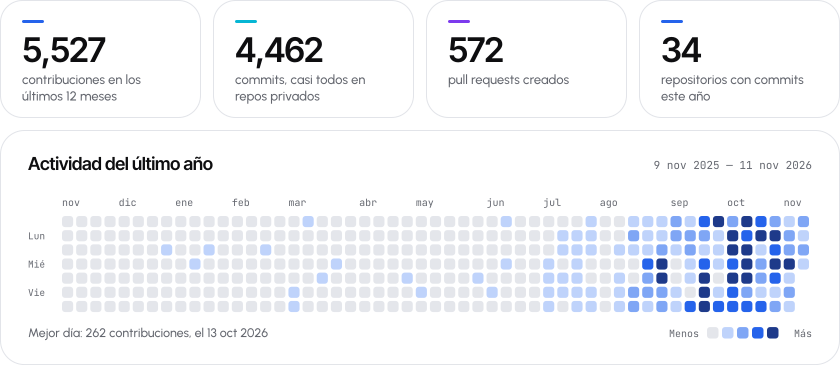</picture>

<picture><source media="(prefers-color-scheme: dark)" srcset="assets/generated/languages-dark.svg">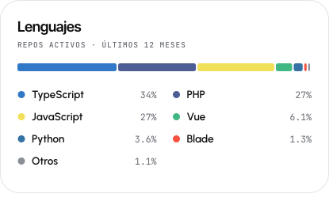</picture><picture><source media="(prefers-color-scheme: dark)" srcset="assets/generated/rhythm-dark.svg">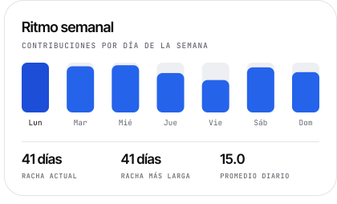</picture>

Se actualiza solo cada día con GitHub Actions. Incluye la actividad en repositorios privados.

### Stack

<picture><source media="(prefers-color-scheme: dark)" srcset="assets/generated/stack-dark.svg">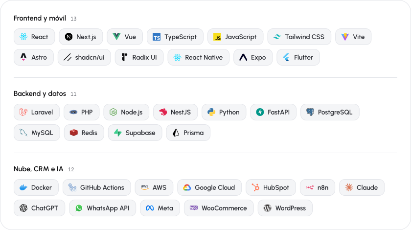</picture>

### Trayectoria

| Periodo | Rol | Dónde |
|---|---|---|
| feb 2026 – hoy | **CRM & AI Manager** | Impulse · HubSpot Diamond Partner |
| mar 2025 – ene 2026 | CRM & Marketing Automation Leader | Protecso · HubSpot Gold Partner |
| mar 2022 – mar 2025 | Full Stack & HubSpot Developer | Impulse |
| 2019 – 2021 | Full Stack Developer | Primeros proyectos: facturación electrónica, apps móviles y sistemas a medida |
| Antes | Docente de computación | 5 años en aula |

- **~75 sitios web** de dos universidades migrados a HubSpot CMS, a un ritmo de 10 por semana.
- **+15 implementaciones** de HubSpot en retail, educación, finanzas, salud y seguros.
- Integración en n8n entre la app de ventas de una financiera y HubSpot: contactos, ventas y asociaciones sincronizados.
- **1er puesto, Innovatec Cajamarca 2019**, con un sistema de gestión académica.

**Formación** — Ingeniero de Sistemas Computacionales, Universidad Privada del Norte (título profesional, 2026) · Inglés intermedio certificado por UPN.

### Certificaciones

| Emisor | Certificación | Vigencia |
|---|---|---|
| **HubSpot Academy** | Solutions Partner | oct 2026 – nov 2028 |
| | Platform Consulting | oct 2026 – nov 2027 |
| | Sales Hub Software | oct 2026 – nov 2027 |
| | Content Hub for Marketers | oct 2026 – nov 2027 |
| | Reporting | oct 2026 – nov 2027 |
| | Data Integrations | oct 2026 – nov 2027 |
| | Integrating With HubSpot I: Foundations | oct 2026 – nov 2027 |
| | AEO Fundamentals | oct 2026 – nov 2028 |
| | AI Essentials · Breeze Essentials for Partners (badges) | desde oct 2026 |
| **Anthropic** | Claude with the Anthropic API | abr 2026 |
| | Claude Code in Action | 2026 |
| | Introduction to Model Context Protocol | abr 2026 |
| | Introduction to agent skills | 2026 |
| **Gestión y agilidad** | Scrum Foundation Professional Certificate (CertiProf) | — |
| | Certified Associate in Scrum Fundamentals (SkillFront) | — |
| | Project Management Essentials (MSI) | — |
| | Six Sigma White Belt | — |
| **Redes y seguridad** | Cisco CCNA 2 | 2018 |
| | Ciberseguridad y Ciberdefensa (UPN) | — |

<b>Formación complementaria</b> — más de 30 cursos

 

- **HubSpot Academy, ciclos anteriores** — Marketing Hub Software, Service Hub Software, Revenue Operations, CMS Hub for Marketers, CMS for Developers, Inbound Marketing, Inbound Sales, Marketing Hub Implementation, Sales Hub Implementation, Objectives-Based Onboarding, Salesforce Integration.
- **IA y WhatsApp** — Desarrollo de chatbots con WhatsApp e inteligencia artificial (Blumbit) · Python Fundamentals for ML (CETI).
- **Desarrollo** — Especialista en desarrollo de software de facturación electrónica con PHP (CETI) · Especialista en desarrollo frontend con Angular y React (CETI) · JavaScript Moderno y Dart: de cero hasta los detalles (DevTalles) · PHP 8 y MySQL, Ecommerce con Laravel, Livewire, Tailwind y Alpine, JavaScript Moderno y Tiendas virtuales con WordPress y WooCommerce (Udemy).
- **Platzi, 19 cursos** — Frontend Developer, HTML y CSS, Mobile First, terminal y línea de comandos, pensamiento lógico, Product Management, comunicación y colaboración en equipos.
- **Growth** — Growth Rockstar, 10.ª edición.

### Escribo sobre esto

- [Migré 6 sistemas a un servidor nuevo y nadie lo notó: el checklist](https://victorllerena.com/contenido/migrar-sistemas-a-otro-servidor)
- [¿Cuánto cuesta un sistema a medida y cuánto tarda?](https://victorllerena.com/contenido/cuanto-cuesta-un-sistema-a-medida)
- [La IA no reemplaza tu CRM: lo vuelve más inteligente](https://victorllerena.com/contenido/la-ia-no-reemplaza-tu-crm)

Más en **[victorllerena.com/contenido](https://victorllerena.com/contenido)**, y en qué ando esta semana en **[/now](https://victorllerena.com/now)**.

<a href="https://victorllerena.com"><picture><source media="(prefers-color-scheme: dark)" srcset="assets/generated/footer-dark.svg"></picture></a>

<a href="https://www.linkedin.com/in/vllerena/">LinkedIn</a> ·
<a href="https://www.youtube.com/@vllerena">YouTube</a> ·
<a href="https://www.instagram.com/victorllerenac">Instagram</a> ·
<a href="https://x.com/llerena_victor">X</a> ·
<a href="https://www.tiktok.com/@victorllerenac">TikTok</a> ·
<a href="https://www.facebook.com/vllerenacaballero">Facebook</a>

